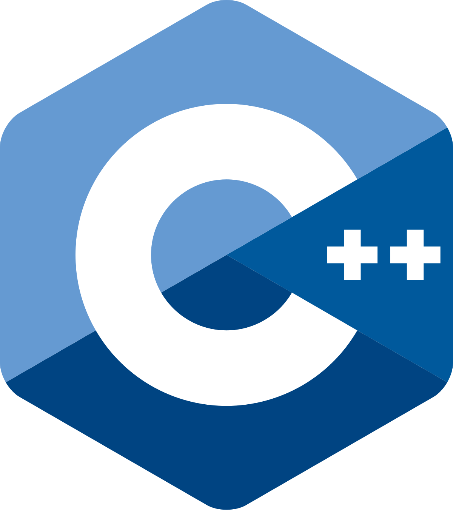

Hi my name is Javi
====================================================================================================================================

* 🌍  I'm based in Palo Alto, California
* 📫  You can contact me at javiercunnat[at]gmail[dot]com or through my [Linkedin](https://linkedin.com/in/javiercunat)
* 🚀  I'm currently working on a stealth startup
* 🧠  I'm learning about computer architecture, distributed systems, and AI

"Beauty in the struggle" -J.Cole

### Tech Stack

### Socials

     

